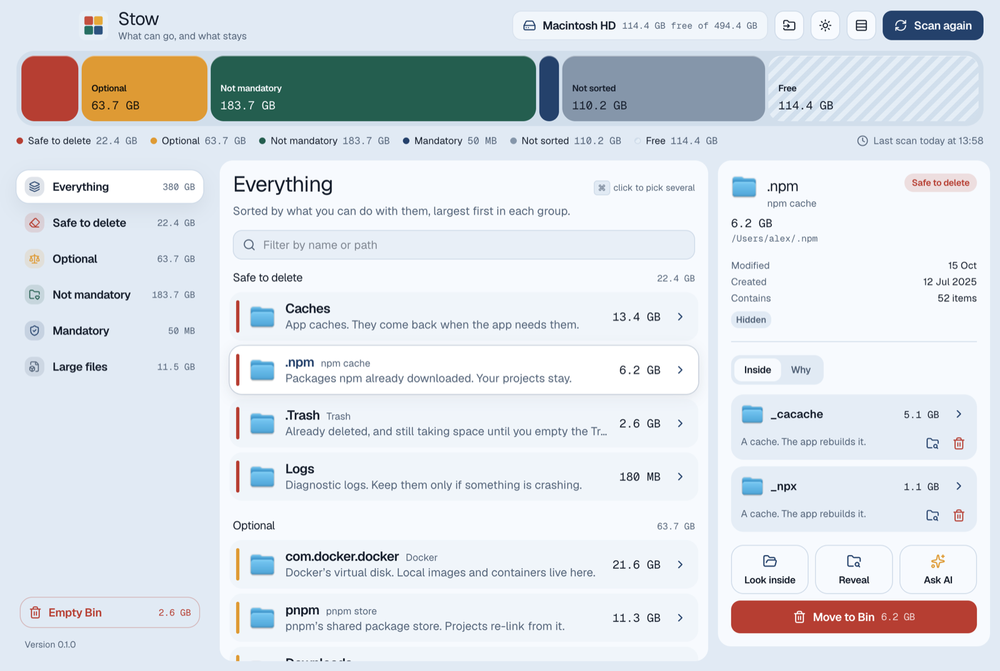
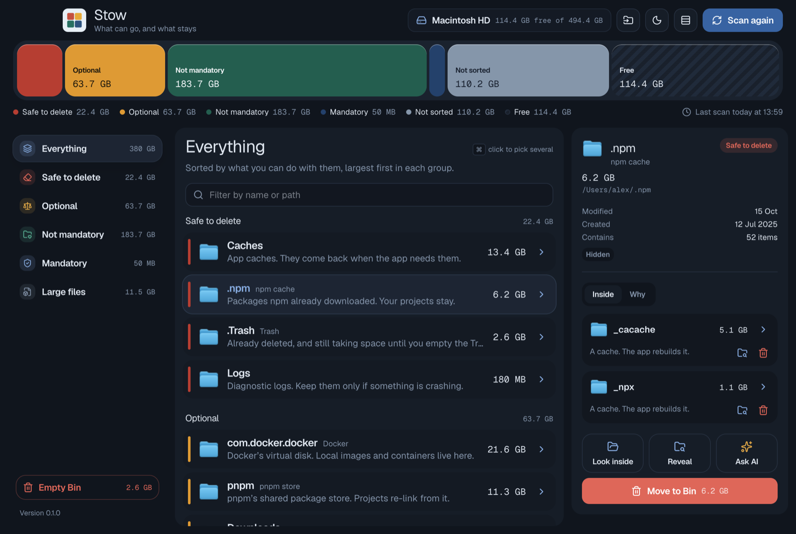
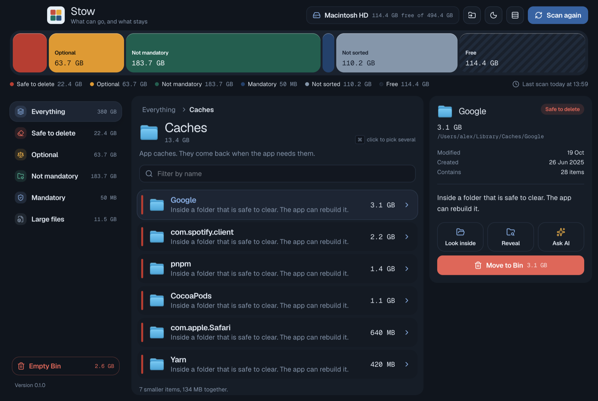
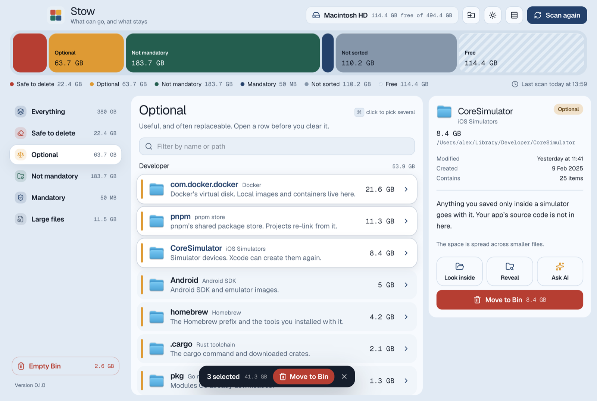

# Stow

See what your Mac is holding, and what it can let go.

**[Website](https://kthilagarajan.github.io/stow/)** · **[Download](https://github.com/kthilagarajan/stow/releases/latest)** · MIT licensed

Stow is a macOS storage analyzer. It measures the places that quietly fill a disk (caches, package stores, Xcode leftovers, simulators, old downloads) and sorts each one by what you can safely do with it. Everything happens on your Mac. Nothing is uploaded.



<table>
  <tr>
    <td></td>
    <td></td>
  </tr>
  <tr>
    <td align="center">Dark mode</td>
    <td align="center">Looking inside a folder</td>
  </tr>
</table>



<sub>Screenshots use Stow's demo mode with made-up data.</sub>

## What it shows

The storage bar across the top splits the disk into five groups. Click a group to see its shelf.

| Shelf | Meaning | Stow can move it to the Bin |
| --- | --- | --- |
| **Safe to delete** | Caches, logs, build leftovers. Apps rebuild them. | Yes |
| **Optional** | Useful, often replaceable: package stores, SDKs, simulators, installers. | Yes, after a look |
| **Not mandatory** | Your files and apps. The Mac runs without them. | No |
| **Mandatory** | What the account needs: keychains, preferences, mail. | No |
| **Not sorted** | Mostly macOS itself, plus folders the scan does not open. | No |

**Large files** lists anything over 500 MB, wherever it sits.

## Using it

- **Scan** measures the Mac. The result is saved, so the next launch opens straight onto it.
- **Click** a row to see why it is on its shelf, when it was modified, created and last opened, and what is inside.
- **Double-click** a folder, or use its arrow, to look inside it.
- **⌘-click** to select several rows, then move them to the Bin together. **⌘A** selects every row that can go and **Esc** clears the selection.
- **⇧⌘G** goes to any folder by path, like Finder's Go to Folder. Outside the usual places, only caches, installers and dependencies can be moved.
- **Ask AI** builds a prompt about the selected folder and opens it in ChatGPT, Claude, Cursor or Codex, or copies it. Stow never sends it anywhere itself.
- The header buttons switch between **light, dark, and matching macOS**, and between roomy and **compact** rows.

Moving to the Bin is always the way out: you can put things back from Finder. **Empty Bin** is the only permanent step, and Stow asks first.

The word follows macOS: in British, Indian and other Commonwealth English it is the **Bin**, and in US English the **Trash**.

### Full Disk Access

macOS hides some folders, the Bin among them, unless an app has Full Disk Access. Stow still works without it. Those sizes may read low, the bin's size shows only once Stow has moved something there, and a note says how many folders were hidden. To let Stow see everything, add it in **System Settings → Privacy & Security → Full Disk Access**.

## Install

Download the `.dmg` for your Mac from the [latest release](https://github.com/kthilagarajan/stow/releases/latest): `arm64` for Apple silicon, `x64` for Intel. Then drag Stow to Applications.

Stow is not notarized by Apple yet, so clear the download flag once before the first launch:

```bash
xattr -cr /Applications/Stow.app
```

### Updates

Stow checks GitHub for a newer release a few seconds after it opens, and every six hours after that. You can also choose **Stow → Check for Updates…**. When one is out, an **Update** button appears in the header. It shows the release notes and downloads the disk image for your chip into Downloads, then opens it so you can drag the new Stow into Applications.

### Privacy

Scanning, sizes and file details stay on your Mac. The only network requests Stow makes are reading public release information from GitHub, and downloading an update when you ask for one.

## Develop

Requires macOS and Node 22 or later. Stow keeps its scan in `node:sqlite`.

```bash
npm install
npm run dev
```

| Command | What it does |
| --- | --- |
| `npm run dev` | Runs the app with hot reload |
| `npm run demo` | Runs the app with made-up data and a separate profile, for screenshots |
| `npm run typecheck` | Type-checks the main process, preload and renderer |
| `npm test` | Runs the unit tests in `src/shared` |
| `npm run build` | Builds into `out/` |
| `npm run dist` | Builds disk images and zips for both chips into `dist/` |

### Releases

`.github/workflows/release.yml` typechecks, tests and builds on every push to `main` and every pull request, and keeps the disk images as a downloadable Actions artifact. Pushing a version tag also publishes a GitHub release with the `.dmg` and `.zip` for both chips. The tag must match `version` in `package.json`.

```bash
npm version 0.2.0 --no-git-tag-version   # bump package.json, then commit it
git tag v0.2.0
git push origin main v0.2.0
```

Installed copies of Stow find the release on their next update check.

### Website

The website in `site/` is an Astro page published to GitHub Pages by `.github/workflows/site.yml` whenever the site, the screenshots or the icon change on `main`. Preview it locally with `npm --prefix site install` and `npm --prefix site run dev`.

### License

[MIT](LICENSE)

### Built with

Electron, React, TypeScript, Tailwind CSS 4, Radix primitives (shadcn/ui style), lucide icons, and the Geist typeface.

See [AGENTS.md](AGENTS.md) for how the code is organized and the rules that keep Stow safe to use.
